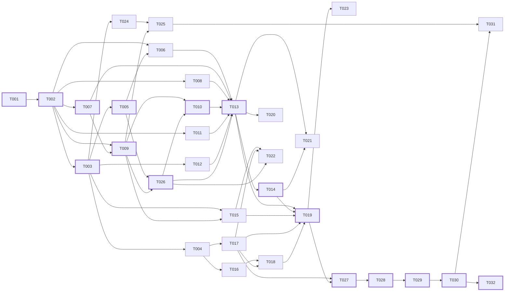

# 08 — Backlog técnico · AI Travel Planner

> **Fase BMAD:** Implementación-planificación · **Agente:** Backlog Builder
> **Insumos:** 07-architecture.md (componentes C-01 a C-20, endpoints §4, ADR-001 a ADR-008, RT-01 a RT-24), 06-user-stories.md (HU-001 a HU-012; el Anexo A, HU-013 a HU-016, queda fuera), 02-alcance.md (F-01 a F-06 Must, F-10 Should)
> **Estado:** Borrador · **Fecha:** 2026-11-07
> **País de operación:** Perú · **Ejecución:** Módulo 2 (en el Módulo 1 no se implementa nada)
> **Revisión 2026-11-07: hallazgos auditoría Clase 2 vuelta 1:** nueva T-026 (contraste de actividades con `PlacesSource`, QB-01); reserva de UI desde T-027; QB-02 a QB-13, QB-15 a QB-20 y QB-22 corregidos en las tareas; QB-26, QB-29 y QB-31 (redacción). DAG verificado de nuevo y ruta crítica recalculada (§3). Quedan para 05: QB-14, QB-21, QB-23, QB-24 y QB-25.
> **Revisión 2026-11-07: triaje de §4 y de la auditoría a 05-preguntas-abiertas.md:** BB-Q1 → PREG-76; BB-Q2 → PREG-06; BB-Q3, BB-Q5 y BB-Q8 → PREG-73; BB-Q4 → PREG-09; BB-Q6 → PREG-30; BB-Q7 → PREG-77; BB-Q9 → PREG-32; BB-Q10 → PREG-78; QB-14 → PREG-77; QB-21, QB-23 y QB-24 → PREG-73; QB-25 → PREG-75; T-024 > 2 h → PREG-74.

**Convenciones**

- **Alcance:** v1 = web responsive Next.js (C-01) + API FastAPI (C-04 a C-17) + Postgres de Supabase Free (C-19, solo cuentas). No hay tareas para C-02 (Expo, post-v1, ADR-007) ni para F-07 a F-09, F-11 o F-12 a F-15.
- **Tamaño:** S < 30 min (0,5 h) · M 30 min–1 h (1 h) · L 1–2 h (2 h). Ninguna tarea supera 2 h.
- **Valores:** salen de 07 y 06 (PAR-01 a PAR-11 son propuestas del BA, PREG-55). Si un valor sigue abierto, la tarea lo deja **configurable** y cita la PREG o la ARQ-Q; nunca lo inventa.
- **Proveedores externos pendientes** (LLM: PREG-13; lugares: PREG-50): el backlog trabaja detrás de los puertos `LlmProvider` y `PlacesSource` con implementaciones *fake* deterministas. El adaptador real de cada proveedor se agregará como tarea cuando se resuelvan esas preguntas.
- **Restricción para el agente de desarrollo (RT-11, PRINCIPIO-007):** no fusiona, no despliega, no toca `docs/adr/`, `specs/**/spec.md`, los lockfiles ni `apps/api/src/atp_api/data/*.yaml`, y no agrega dependencias. Las dependencias que necesita el backlog se listan en BB-Q1 para que Pavel las apruebe antes de T-001.
- **Criterio de completitud:** siempre binario (sí/no) y ejecutable: un comando que sale con código 0 o un test concreto que pasa.
- **Extensión para la Clase 3:** las tareas de UI ligadas a pantallas se numeran **desde T-027** (T-026 pasó a ser el contraste de actividades con `PlacesSource`, QB-01), con el mismo formato y una línea adicional `Pantalla: P-NNN`. T-019 (walking skeleton web) es UI mínima sin diseño y la reemplazarán esas tareas.
- **Numeración y orden:** los números son identificadores estables, no un orden de ejecución. Una tarea puede depender de otra con número mayor (T-010, T-013 y T-022 dependen de T-026); el orden de ejecución recomendado es el orden topológico de §3.3.

---

## 1. Índice

| T | Título | HU | C-NN | Plataforma | Prioridad | Tamaño | Dependencias |
|---|---|---|---|---|---|---|---|
| T-001 | Scaffold del monorepo, CI de calidad y CODEOWNERS | Habilitadora (HU-001 a HU-012) | C-04, C-01, C-03 | infraestructura | Must | L | Ninguna |
| T-002 | Parámetros PAR, enums y modelos de dominio estrictos | Habilitadora (HU-001 a HU-012) | C-04 | backend | Must | L | T-001 |
| T-003 | Base de la API /v1, errores, observabilidad y /v1/health | HU-001, HU-006 | C-04, C-14 | backend | Must | L | T-002 |
| T-004 | Contrato OpenAPI → core y cliente HTTP con plazos PAR-09 | HU-006 | C-03 | core | Must | M | T-003 |
| T-005 | Puerto PlacesSource y GET /v1/destinations/resolve | HU-002 | C-15 | backend | Must | M | T-003 |
| T-006 | Validación de TripRequest (RN-001 a RN-016, RN-095) | HU-002, HU-003 | C-05 | backend | Must | L | T-002, T-005 |
| T-007 | Cargadores del registro de fuentes y de enlaces oficiales | HU-007, HU-008 | C-16, C-17 | backend | Must | M | T-002 |
| T-008 | Contexto del LLM (lista permitida) y adaptador LlmProvider | HU-003, HU-004 | C-06, C-08 | backend | Must | L | T-002 |
| T-009 | Capa de verificación: estados, vigencia y atestación HMAC | HU-008, HU-009 | C-10 | backend | Must | L | T-002, T-007 |
| T-010 | Validación de salida del LLM y reglas de itinerario | HU-004, HU-005, HU-007 | C-09 | backend | Must | L | T-009, T-026 |
| T-011 | Guardia de contenido y golden set inicial | HU-009 | C-11 | backend | Must | M | T-002 |
| T-012 | Límite de operaciones por dispositivo y GET /v1/quota | HU-006 | C-12 | backend | Must | M | T-003 |
| T-013 | Orquestación y POST /v1/itineraries/generate | HU-004, HU-006 | C-07 | backend | Must | L | T-006, T-007, T-008, T-010, T-011, T-012, T-026 |
| T-014 | Ajustes sin estado: alternative y regenerate-day | HU-010, HU-011 | C-07 | backend | Must | L | T-013 |
| T-015 | POST /v1/itineraries/reliability/refresh | HU-001, HU-008 | C-10 | backend | Must | M | T-003, T-009 |
| T-016 | GuestTripStore sobre IndexedDB y lint de almacenamiento | HU-001 | C-18 | core | Must | L | T-004 |
| T-017 | Recursos i18n es-419 y formateadores de estados | HU-007, HU-008 | C-03 | core | Must | M | T-004 |
| T-018 | Controlador de operaciones del invitado (red, pendientes, eliminar) | HU-001, HU-006, HU-010, HU-011 | C-03 | core | Must | L | T-016, T-017 |
| T-019 | Walking skeleton web del flujo invitado | HU-001, HU-002, HU-003, HU-007, HU-010, HU-011 | C-01 | web | Must | L | T-013, T-014, T-015, T-017, T-018 |
| T-020 | Test de reglas Must de la solicitud (RN-001 a RN-016, RN-095) | HU-002, HU-003 | C-05 | backend | Must | M | T-013 |
| T-021 | Test de reglas Must del itinerario y de la orquestación | HU-004, HU-005, HU-011 | C-09, C-07 | backend | Must | L | T-013, T-014 |
| T-022 | Test de los 3 estados de confiabilidad (PRINCIPIO-003) | HU-008, HU-009 | C-10, C-03 | backend | Must | L | T-015, T-017, T-026 |
| T-023 | E2E del flujo invitado en 3 viewports y 0 filas (PRINCIPIO-005) | HU-001 | C-01, C-18, C-19 | web | Must | L | T-019 |
| T-024 | Esquema de cuentas (Alembic + RLS) y autenticación propia | HU-012 | C-13, C-19 | backend | Should | L | T-003 |
| T-025 | Asociación de viajes con consentimiento y lectura de viajes | HU-012 | C-13, C-10 | backend | Should | L | T-024, T-009 |
| T-026 | Contraste de actividades con PlacesSource | HU-004, HU-005, HU-009 | C-10, C-15 | backend | Must | L | T-005, T-009 |
| T-027 | Componentes base de UI y design tokens (UI-01 a UI-26, a11y) | HU-007, HU-008 | C-01, C-03 | web | Must | L | T-017, T-019 |
| T-028 | Pantalla P-001 (Solicitud de viaje) con desambiguación y validación | HU-001, HU-002, HU-003, HU-006 | C-01 | web | Must | L | T-027 |
| T-029 | Pantalla P-002 (Estado de generación) y transiciones de error | HU-004, HU-005, HU-006 | C-01 | web | Must | M | T-028 |
| T-030 | Pantalla P-003 (Itinerario por días interactivo, ajustes y refresh) | HU-001, HU-004, HU-005, HU-007, HU-008, HU-010, HU-011 | C-01, C-18 | web | Must | L | T-029 |
| T-031 | Pantallas P-004 a P-006 (Modo cuenta y asociación de viajes) | HU-012 | C-01, C-13 | web | Should | L | T-025, T-030 |
| T-032 | Auditoría automatizada de accesibilidad (axe-core) y responsive | HU-001 a HU-011 | C-01 | web | Must | M | T-030 |

Cuando una tarea toca varios componentes, el primero de la columna C-NN es el principal.

---

## 2. Detalle de las tareas

### 2.1 Setup e infraestructura

**T-001: Scaffold del monorepo, CI de calidad y CODEOWNERS**
- **HU relacionada:** Habilitadora de HU-001 a HU-012 (infraestructura)
- **Componente:** C-04 API backend; C-01 Cliente web; C-03 Paquete `core`
- **Plataforma:** infraestructura
- **Prioridad:** Must
- **Tamaño:** L
- **Dependencias:** Ninguna
- **Descripción:** Crear la estructura de §2.2 de 07: pnpm workspaces (`apps/web` Next.js App Router con TypeScript `"strict": true` y `noUncheckedIndexedAccess`, `packages/core`) y uv (`apps/api`, Python 3.12, paquete `atp_api` con las carpetas de §2.2), más `docker-compose.yml` con un Postgres local para los tests. Configurar la CI con Ruff, `mypy --strict`, `tsc`, ESLint + `typescript-eslint`, gitleaks, `pytest --cov-fail-under=80` y Vitest con umbral del 80 % en `core` (RT-16), y el archivo CODEOWNERS sobre `docs/adr/`, `specs/**/spec.md`, los lockfiles y `apps/api/src/atp_api/data/*.yaml` (RT-11). Gates constitucionales de CI (QB-20; 07 ADR-002): (a) check `spec-check` (`scripts/check_spec.py`) que lee `Spec: NNN` en la descripción del PR y falla si `specs/NNN-*/spec.md` no existe o su frontmatter no tiene `status: approved`, `approver`, `approved_at` y `version`; la etiqueta `no-spec`, puesta por una persona, lo omite (RT-01, PRINCIPIO-001); (b) job `golden` (`uv run pytest tests/golden -q`) obligatorio en todo PR que toque `apps/api/src/atp_api/orchestration/`, `adapters/llm/`, `reliability/` o `content_guard/` (filtro por rutas; los prompts viven en `orchestration/` o `adapters/llm/`, porque §2.2 de 07 no define otra carpeta); el directorio `tests/golden/` lo crea T-011, y hasta entonces el job se declara pero no hay PR que lo dispare con contenido; (c) `eslint-plugin-jsx-a11y` (configuración `recommended`) en el lint de `apps/web` (PRINCIPIO-010). La protección de `main` depende del servicio de CI (ARQ-Q-31) y la configura Pavel (RT-11). `apps/mobile/` queda vacío (post-v1).
- **Criterio de completitud:** en un clon limpio, `pnpm install && pnpm -r lint && pnpm -r typecheck && (cd apps/api && uv run ruff check . && uv run mypy --strict src) && gitleaks detect --no-git -s .` termina con código 0, y `.github/CODEOWNERS` (o el equivalente del servicio de CI, ARQ-Q-31) contiene las 4 rutas de RT-11; `uv run python scripts/check_spec.py --body "Arreglo menor"` sale con 1 y `uv run python scripts/check_spec.py --body "Spec: 001" --specs tests/fixtures/specs` sale con 0 sobre un fixture `specs/001-demo/spec.md` con `status: approved` (y con 1 si dice `status: draft`); la configuración de CI declara el job `golden` con el filtro de las 4 rutas; y `pnpm --filter web lint` falla sobre un fixture con `` sin `alt` (`jsx-a11y/alt-text`).

**T-002: Parámetros PAR, enums y modelos de dominio estrictos**
- **HU relacionada:** Habilitadora de HU-001 a HU-012 (infraestructura)
- **Componente:** C-04 API backend (`domain/`)
- **Plataforma:** backend
- **Prioridad:** Must
- **Tamaño:** L
- **Dependencias:** T-001
- **Descripción:** Implementar `domain/params.py` como única fuente de PAR-01 a PAR-11 (14 días, 365 días, 10 viajeros, franjas 06–12/12–18/18–23, 360/480/600 min, descanso ≥ 60 min, 15 operaciones / 24 h, 5 viajes locales, 60 s / 30 s, 1 reintento, 3 s), los enums de §3.1 y los modelos Pydantic v2 de §3.2 (`FactualDatum`, `TripRequest`, `Itinerary`, `Day`, `Activity`, `Notices`, `GenerationMeta`, `ErrorBody` (con `error.params?: object` para los parámetros del `message_key` de nivel superior, p. ej. `retry_at` del 429; QB-18) y `LlmItineraryOutput` con `LlmReliabilityStatus` **sin `verified`**), todos con `ConfigDict(extra="forbid", strict=True)` (RT-04). `FactualDatum` exige los campos condicionales por estado (`source`/`valid_until`/`attestation` si `verified`; `estimation_basis` si `estimated`; `suggested_source` si `to_confirm`) y `value = null` solo con `to_confirm` (RN-071, RT-02).
- **Criterio de completitud:** `uv run pytest tests/domain -q` pasa e incluye: (a) `LlmItineraryOutput` con un dato `"reliability_status": "verified"` lanza `ValidationError`; (b) `TripRequest` con `"child_name": "Mateo"` lanza `ValidationError`; (c) un `FactualDatum` `verified` sin `source` lanza `ValidationError`; (d) `params.PACE_LIMIT_MIN == {"relaxed": 360, "balanced": 480, "active": 600}` y `params.QUOTA_LIMIT == 15`; (e) `ErrorBody` serializa `{"error": {…, "params": {"limit": 15, "retry_at": "2026-12-02T01:05:00Z"}}}` sin `ValidationError`.

**T-003: Base de la API /v1, errores, observabilidad y /v1/health**
- **HU relacionada:** HU-001, HU-006
- **Componente:** C-04 API backend; C-14 Observabilidad y salud
- **Plataforma:** backend
- **Prioridad:** Must
- **Tamaño:** L
- **Dependencias:** T-002
- **Descripción:** Crear la app FastAPI con el router `/v1`, `X-Request-Id`, gzip, CORS con lista permitida, límite de cuerpo de 256 KiB → 413 `payload_too_large` (RT-22) y mapeo de excepciones a `ErrorBody` con `message_key` para 400/401/404/409/413/422/429/502/503/504 (tabla de §4; 502/503/504 con `retryable: true`). Configurar `structlog` con un procesador de lista blanca (`request_id`, `route`, `status`, `duration_ms`; `provider` y `model_version` detrás de un flag apagado hasta PREG-66) (RN-097, RT-06). Implementar `GET /v1/health` (§4.10) con `SELECT 1` contra `DATABASE_URL` → 200 `{"status":"ok","db":"ok","checked_at":"…Z"}` o 503 `{"status":"degraded","db":"unreachable","checked_at":"…Z"}`, sin escribir filas. Uvicorn con 1 worker (ADR-008). **Migración base mínima (QB-13):** entorno Alembic (`apps/api/alembic.ini`, `migrations/env.py` que lee `DATABASE_URL`) con la revisión `0001_baseline`, que no crea ninguna tabla (en particular, ninguna de invitados: PRINCIPIO-005); T-024 agrega sobre ella la revisión de cuentas y T-023 aplica `alembic upgrade head` antes de contar filas.
- **Criterio de completitud:** `uv run pytest tests/api/test_base.py tests/observability -q` pasa con: un cuerpo de 262 145 bytes → 413 `payload_too_large`; un campo no declarado → 422 con `details[0].code == "field_not_allowed"` y sin el valor del campo; `/v1/health` con la base caída → 503 `degraded` y `checked_at` en UTC con `Z`; un test que captura los logs de una solicitud y falla si aparece una clave fuera de la lista blanca de C-14; y `uv run alembic upgrade head` sale con 0 sobre el Postgres local.

**T-004: Contrato OpenAPI → core y cliente HTTP con plazos PAR-09**
- **HU relacionada:** HU-006
- **Componente:** C-03 Paquete `core`
- **Plataforma:** core
- **Prioridad:** Must
- **Tamaño:** M
- **Dependencias:** T-003
- **Descripción:** Script que exporta `openapi.json` desde FastAPI y genera `packages/core/src/api/schema.d.ts` (`openapi-typescript`) y `packages/core/src/params.json` desde `domain/params.py`; paso de CI con `git diff --exit-code` (RT-13). Cliente `openapi-fetch` en `core` que agrega `X-Device-Id`, aborta con `AbortController` a los 60 s en `generate` y a los 30 s en `alternative` y `regenerate-day` (PAR-09, RT-17), y hace **0 reintentos automáticos** en operaciones de IA (RT-18, RN-093).
- **Criterio de completitud:** `pnpm --filter core gen && git diff --exit-code packages/core/src` sale con 0, y `pnpm --filter core test http-client` pasa con temporizadores falsos: la solicitud de `generate` sigue viva a los 59 999 ms y se aborta a los 60 000 ms; la de `regenerate-day` se aborta a los 30 000 ms; ante un 503, `fetch` se llamó exactamente 1 vez.

### 2.2 Features del backend

**T-005: Puerto PlacesSource y GET /v1/destinations/resolve**
- **HU relacionada:** HU-002
- **Componente:** C-15 Adaptador de fuente de lugares
- **Plataforma:** backend
- **Prioridad:** Must
- **Tamaño:** M
- **Dependencias:** T-003
- **Descripción:** Definir el puerto `PlacesSource` (`resolve(text, near: str | None = None) → candidates`, donde `near` es el `place_ref` del destino y lo usa T-026 para las actividades; `lookup(place_ref) → place` con existencia, cierre permanente, horario y edad mínima si la fuente los da) y un `FakePlacesSource` con fixtures de destinos ("Cusco" → 1 candidato; "Arequipa" → 1 candidato, usado por T-023; "San Juan" → 2 candidatos; "Qwzxy" → 0; un modo que falla). Los fixtures de actividades los agrega T-026. Implementar `GET /v1/destinations/resolve` (§4.1): `status` ∈ `resolved`/`ambiguous`/`not_found` (RN-007), `q` de 2–100 caracteres (si no, 422) y 502 `places_unavailable` si la fuente falla (texto y plazo: PREG-64). El texto `q` no se registra en los logs (RN-097) ni llega al LLM (RN-096). El proveedor real queda pendiente (PREG-50).
- **Criterio de completitud:** `uv run pytest tests/api/test_destinations.py -q` pasa con: "San Juan" → 200 `ambiguous` con 2 candidatos; "Qwzxy" → 200 `not_found`; `q="C"` → 422; fuente caída → 502 `places_unavailable`; y la captura de logs de esas solicitudes no contiene la cadena "San Juan".

**T-006: Validación de TripRequest (RN-001 a RN-016, RN-095)**
- **HU relacionada:** HU-002, HU-003
- **Componente:** C-05 Validación de solicitud
- **Plataforma:** backend
- **Prioridad:** Must
- **Tamaño:** L
- **Dependencias:** T-002, T-005
- **Descripción:** Validadores de dominio sobre `TripRequest` (§3.2): fecha existente (RN-002, `date_not_exists`), fin ≥ inicio (RN-003), inicio ≥ hoy y ≤ hoy + 365 días tomando "hoy" en America/Lima con un reloj inyectable (RN-004, RN-006, PREG-23/PREG-67), duración ≤ 14 días (RN-005, `trip_too_long` con `max_days: 14`), un solo `group_type` y composición del glosario (Solo = 1 adulto y 0 menores; Pareja = 2 y 0; Amigos = 2–10 adultos y 0 menores; Familia = ≥ 1 adulto y ≥ 1 menor; `family_requires_child`) (RN-008, RN-011), `adults ≥ 1` (RN-009), total ≤ 10 (RN-010), `AgeRange` del catálogo (RN-012), `group_needs` del catálogo sin duplicados y solo a nivel de grupo (RN-014, RN-015), un `pace` (RN-016) y 422 `field_not_allowed` por campo no declarado (RN-095). El destino se vuelve a resolver con `PlacesSource.lookup(place_ref)`.
- **Criterio de completitud:** `uv run pytest tests/validation -q` pasa con al menos estos casos: fin 2027-02-30 → `date_not_exists`; 2027-01-10 a 2027-01-23 aceptado y 2027-01-10 a 2027-01-24 → `trip_too_long`; Familia con 2 adultos y 0 menores → `family_requires_child`; 4 adultos + 6 menores aceptado y 4 + 7 rechazado. La suite completa de bordes está en T-020.

**T-007: Cargadores del registro de fuentes y de enlaces oficiales**
- **HU relacionada:** HU-007, HU-008
- **Componente:** C-16 Registro de fuentes; C-17 Lista curada de enlaces oficiales
- **Plataforma:** backend
- **Prioridad:** Must
- **Tamaño:** M
- **Dependencias:** T-002
- **Descripción:** Modelos Pydantic y cargadores que validan al arrancar `source_registry.yaml` (`source_id`, nombre visible, dominios permitidos, categorías que puede verificar, vigencia declarada, `suggested_source_key` por categoría) y `official_links.yaml` (país ISO 3166-1 alfa-2 → enlaces con `reviewed_at`); si un archivo no valida, la API no arranca. Agregar el test de CI que falla si algún `reviewed_at` tiene más de 30 días (RN-024, DEP-04, RT-23). Función pura `build_notices(country_code) → Notices` (`suggestion.message_key = "itinerary.notice.suggestion"`, RN-026; `immigration.message_key = "itinerary.notice.immigration"` con los enlaces de C-17 del país, RN-024), que T-013 solo invoca (se trasladó desde T-013 para que esta quepa en 2 h, QB-22). El agente trabaja con archivos de **fixture** en `tests/fixtures/`; el contenido real de `data/*.yaml` lo escribe Pavel (CODEOWNERS, RT-11; PREG-06, PREG-04).
- **Criterio de completitud:** `uv run pytest tests/data -q` pasa con: el fixture válido carga; un fixture con `reviewed_at` de hace 31 días respecto del reloj inyectado hace fallar el test de vigencia (y con 30 días pasa); un `source_registry` con un `source_id` duplicado lanza un error al cargar; `build_notices("PE")` devuelve las dos claves y los enlaces PE del fixture, y con un país sin entrada en el fixture el aviso migratorio sigue presente (RN-024; enlaces en ese caso: PREG-04, ARQ-Q-24).

**T-008: Contexto del LLM (lista permitida) y adaptador LlmProvider**
- **HU relacionada:** HU-003, HU-004
- **Componente:** C-06 Constructor de contexto del LLM; C-08 Adaptador de LLM
- **Plataforma:** backend
- **Prioridad:** Must
- **Tamaño:** L
- **Dependencias:** T-002
- **Descripción:** Función pura `build_llm_context` que arma el payload **solo** con `destination` (nombre resuelto), `start_date`, `end_date`, `group_type`, `adults`, `children_age_ranges`, `group_needs` y `pace`, más el resumen de actividades existentes en los ajustes; nunca IP, `user_id`, `device_id` ni texto escrito por el viajero (RN-096, RT-05). Puerto `LlmProvider.complete_structured(prompt, schema, deadline) → (raw_json, provider_id, model_version)` en `adapters/llm/` con selección por `LLM_PRIMARY` / `LLM_SECONDARY` (ADR-006) y un `FakeLlmProvider` con respuestas de fixture (válida; 3 días para 4; 5 días para 4; dato con `verified`; precio sin `reliability_status`; 503; demora). Prohibir el SDK fuera de `adapters/llm/` con Ruff `TID251` e `import-linter` (RT-13).
- **Criterio de completitud:** `uv run pytest tests/llm_context --cov=atp_api.llm_context --cov-fail-under=100 -q` pasa e incluye el caso "Cusco con mi hijo Mateo" (el payload serializado no contiene "Mateo" y su conjunto de claves es exactamente el de los 8 campos) y el caso RN-037 (con un menor de 0–2 y ritmo Activo, `payload["pace"] == "active"`, igual al de la solicitud), y `uv run lint-imports` sale con código 0.

**T-009: Capa de verificación: estados, vigencia y atestación HMAC**
- **HU relacionada:** HU-008, HU-009
- **Componente:** C-10 Capa de verificación y confiabilidad
- **Plataforma:** backend
- **Prioridad:** Must
- **Tamaño:** L
- **Dependencias:** T-002, T-007
- **Descripción:** En `reliability/`: (1) `assign_status(llm_datum, evidence: Evidence | None, registry, now) → FactualDatum` convierte cada dato del LLM en `FactualDatum`. `Evidence` = `{category, value, source_id, checked_at}`: el tipo lo define esta tarea y lo produce T-026 al contrastar cada actividad con C-15 (07 §4.2 paso 4). Solo asigna `verified` si hay evidencia, su `source_id` está en C-16, la categoría está permitida para esa fuente y hay vigencia (RN-063, RN-064, RN-106; ADR-003 punto 3); si no, `estimated` con `estimation_basis` o `to_confirm` con `suggested_source` (RN-065 a RN-067). (2) `valid_until` = `checked_at` + 7 días para `price`, `opening_hours`, `min_age`, `height_restriction`, `health_restriction` y `accessibility`; la vigencia declarada por la fuente para `availability`, `weather` y `travel_time`; sin vigencia declarada no hay `verified` (RN-068, RN-070). (3) `attestation` = `v1.{kid}.{base64url(HMAC-SHA256)}` sobre el JSON canónico (claves ordenadas, UTF-8) de `fact_id`, `category`, `value`, `source_id`, `checked_at` y `valid_until`, con la clave `ATTESTATION_KEY_{kid}` del entorno (ADR-005); la misma función canónica firma y verifica. (4) `verify_incoming(datum, now)` para los `verified` que envía el cliente, con la semántica única de 07 §3.2 (QB-03): dato mal formado → `MalformedReliabilityDatum` (la API responde 422 `reliability_datum_malformed`, caso b); atestación que no verifica, o `source_id` fuera de C-16 sin atestación válida → `InvalidAttestation` (422 `invalid_attestation`, caso c, rechazo); atestación válida → `effective_status(datum, now)`, que sigue `verified` si `now ≤ valid_until` y la fuente sigue registrada y, si no, devuelve `to_confirm` con `reason` `expired` o `source_removed` (caso d, vigencia); nunca sube de estado (RN-107). (5) `place.existence` (RN-105, QB-02) = `verified` si `lookup` confirmó el lugar con evidencia de un `source_id` registrado para `place_existence`; si no hay evidencia (lugar no encontrado o fuente caída), `to_confirm` con `suggested_source.local_tourism_office`. La vigencia de `place_existence` sigue abierta en PREG-01 (ARQ-Q-25): hasta resolverla se trata como las categorías de vigencia declarada por la fuente (sin vigencia declarada, no hay `verified`).
- **Por qué cabe en 2 h (QB-22):** son funciones puras sobre los modelos de T-002 y el registro de T-007, con `hmac` de la stdlib; el contraste con la fuente de lugares está en T-026, el respaldo de presentación en el cliente en T-017 y los bordes con cobertura del 100 % en T-022.
- **Criterio de completitud:** `uv run pytest tests/reliability/test_assign.py tests/reliability/test_attestation.py -q` pasa con: un dato `verified` con un `value` alterado → `verify_incoming` lanza `InvalidAttestation`; un `verified` con `source: ""` → `MalformedReliabilityDatum`; un `source_id` retirado del registro con atestación válida → `to_confirm` / `source_removed`; un dato `to_confirm` nunca sale como `verified` de `effective_status`; `place_existence` sin evidencia → `reliability_status == "to_confirm"` y `suggested_source.key == "suggested_source.local_tourism_office"` (RN-105). (Bordes y cobertura del 100 %: T-022.)

**T-010: Validación de salida del LLM y reglas de itinerario**
- **HU relacionada:** HU-004, HU-005, HU-007
- **Componente:** C-09 Validación de salida y reglas de itinerario
- **Plataforma:** backend
- **Prioridad:** Must
- **Tamaño:** L
- **Dependencias:** T-009, T-026
- **Descripción:** Fase 1 (antes de C-10): validar `raw_json` contra `LlmItineraryOutput`, sin completar estados faltantes (RN-109); exactamente `end_date − start_date + 1` días con fechas consecutivas (RN-017, RN-110); cada actividad con un `slot` y un `duration_min` (RN-018, RN-020, RN-022). Fase 2 (después de C-10, sobre los `FactualDatum` que asignan T-009 y T-026): calcular `daily_load_min` = duraciones + traslados y exigir ≤ 360/480/600 según el ritmo (RN-027 a RN-029, PAR-05); si hay un menor de 0–2 o 3–5, al menos un bloque `rest` ≥ 60 min por día (RN-033, PAR-06); excluir por `min_age` `verified` mayor que el límite superior del rango de algún menor e incluir con `min_age_notice = {"message_key": "activity.min_age.check_each_child"}` si es mayor que el límite inferior y ≤ el superior (RN-030, RN-031; QB-15: el backend devuelve la clave, nunca el texto, DP-08); excluir lugares cerrados permanentemente o cerrados ese día según un horario `verified` (RN-021, RN-111); sin actividades duplicadas (RN-040); `age_guidance` como orientación, nunca restricción (RN-034). Devuelve una lista de violaciones; con violaciones la salida es inválida (ADR-003 punto 6, ARQ-Q-11).
- **Por qué cabe en 2 h (QB-22):** la fase 1 reutiliza el modelo estricto `LlmItineraryOutput` de T-002 y solo agrega el conteo de días; la fase 2 son funciones puras sobre listas, con la evidencia ya asignada por T-026; los bordes de cada regla están en T-021.
- **Criterio de completitud:** `uv run pytest tests/itinerary_rules -q` pasa con: 3 días para una solicitud de 4 → violación `day_count`; un día Relajado de 361 min → violación `load_exceeded`; un menor de 6–11 y `min_age` 12 ✓ → actividad excluida; un menor de 6–11 y `min_age` 8 ✓ → actividad incluida con `min_age_notice.message_key == "activity.min_age.check_each_child"`; un menor de 3–5 sin bloque `rest` → violación `rest_block_missing`. (Bordes completos: T-021.)

**T-011: Guardia de contenido y golden set inicial**
- **HU relacionada:** HU-009
- **Componente:** C-11 Guardia de contenido
- **Plataforma:** backend
- **Prioridad:** Must
- **Tamaño:** M
- **Dependencias:** T-002
- **Descripción:** Lista de patrones versionada en `content_guard/` aplicada a `name`, `description` y `age_guidance.message_text`: rechaza URLs de reserva, pago o afiliados (RN-023), requisitos migratorios o sanitarios redactados (RN-025, RN-104), calificativos de "seguro" sin fuente (RN-104) y datos factuales en texto libre (RN-059, RN-102). Crear `tests/golden/` con los casos de HU-009 y HU-005; el mecanismo definitivo para el texto libre sigue en PREG-05 (ARQ-Q-12).
- **Criterio de completitud:** `uv run pytest tests/golden -q` pasa con: "Abre a las 9:00 y los domingos la entrada es gratis" → rechazado; "Para entrar a Chile solo necesitas tu DNI vigente" → rechazado; "Barranco es una zona totalmente segura de noche" → rechazado; "Prohibido para menores de 6 años" en `age_guidance` → rechazado; "Reserva aquí: https://ejemplo-tours.com/valle?aff=123" en `description` → rechazado (RN-023); "Colección de cerámica precolombina" → aceptado.

**T-012: Límite de operaciones por dispositivo y GET /v1/quota**
- **HU relacionada:** HU-006
- **Componente:** C-12 Límite de operaciones
- **Plataforma:** backend
- **Prioridad:** Must
- **Tamaño:** M
- **Dependencias:** T-003
- **Descripción:** Almacén en memoria del proceso `HMAC-SHA256(QUOTA_KEY, device_id) → [timestamps]` con ventana móvil de 24 h y purga de vencidos (ADR-008; ventana: PREG-30). API `reserve()` con `asyncio.Lock`, `confirm()` tras un 200 y `release()` ante 5xx o corte (RN-089); 429 `quota_exceeded` con `params.retry_at` = operación más antigua + 24 h y `Retry-After` en segundos (RN-043, §4.6). `GET /v1/quota` devuelve `limit`, `used`, `remaining`, `window_hours`, `retry_at`; sin `X-Device-Id` UUID v4 → 422. Que `no_valid_option` cuente o no es un flag de configuración sin valor fijado (ARQ-Q-08, BB-Q6).
- **Criterio de completitud:** `uv run pytest tests/quota -q` pasa con: la operación 15 se acepta y la 16 → 429; primera operación 2026-12-01T01:05Z y la 16 a 2026-12-01T23:40Z → `retry_at == "2026-12-02T01:05:00Z"` y `Retry-After: 5100`; 10 confirmadas + 2 liberadas → `remaining == 5`; dos reservas concurrentes con 14 usadas → exactamente una aceptada; a 2026-12-02T01:05Z se vuelve a aceptar.

**T-013: Orquestación y POST /v1/itineraries/generate**
- **HU relacionada:** HU-004, HU-006
- **Componente:** C-07 Orquestación de generación
- **Plataforma:** backend
- **Prioridad:** Must
- **Tamaño:** L
- **Dependencias:** T-006, T-007, T-008, T-010, T-011, T-012, T-026
- **Descripción:** Caso de uso `generate` con el pipeline de §4.2 de 07: C-05 → C-15 → C-12 `reserve` → C-06 → C-08 → C-09 fase 1 → C-10 (`contrast_activity` de T-026 por actividad + `assign_status` de T-009) → C-09 fase 2 → C-11 → C-12 `confirm` → 200 con `itinerary`, `notices` (de `build_notices(country_code)` de T-007: RN-024, RN-026), `generation_meta` (`provider`, `model_version`, `attempts`) y `quota`. Ante salida inválida, 1 reintento (PAR-10, RN-085) y luego 502 `generation_invalid_output`; proveedor caído → secundario si está configurado (RN-086), si no 503 `ai_unavailable`; plazo `GENERATE_DEADLINE_S` (< 60 s; valor por configuración, ARQ-Q-10) → 504 `generation_timeout`; en 5xx se libera el cupo (RN-089). No escribe en la base (PRINCIPIO-005).
- **Por qué cabe en 2 h (QB-22):** la tarea compone componentes ya construidos (C-05, C-06, C-08, C-09, C-10, C-11, C-12) y no implementa reglas; los avisos los arma `build_notices` (T-007) y el contraste por actividad, T-026.
- **Criterio de completitud:** `uv run pytest tests/api/test_generate.py -q` pasa con el `FakeLlmProvider`: la solicitud de ejemplo de §4.2 (Cusco, 2026-12-18 a 2026-12-21, Familia, 2 adultos, `["3-5"]`, `["stroller"]`, `balanced`) → 200 con 4 días y `notices.immigration.links` no vacío; fixture inválido y reintento válido → 200 con `attempts == 2`; dos inválidos → 502 y `GET /v1/quota` muestra `used` sin cambios; 503 del primario con secundario configurado → 200 con `provider` del secundario; con `GENERATE_DEADLINE_S=1` y el fixture de demora → 504 `generation_timeout` con `retryable: true` y `GET /v1/quota` con `used` sin cambios (RN-083, RN-089).

**T-014: Ajustes sin estado: alternative y regenerate-day**
- **HU relacionada:** HU-010, HU-011
- **Componente:** C-07 Orquestación de generación
- **Plataforma:** backend
- **Prioridad:** Must
- **Tamaño:** L
- **Dependencias:** T-013
- **Descripción:** `POST /v1/itineraries/alternative` (§4.3) y `POST /v1/itineraries/regenerate-day` (§4.4): validan `trip_request` + `itinerary` + `target` con los esquemas de §4.2, verifican cada atestación con `verify_incoming` de T-009 (semántica única de 07 §3.2, QB-03: atestación inválida → 422 `invalid_attestation`; vencida o con fuente retirada → `to_confirm` con `expired` / `source_removed`; ADR-005), y reusan C-06 (con el resumen de actividades), C-08, C-09, C-10, C-11 y C-12. La alternativa debe quedar en el mismo `day_number` y `slot` (RN-039) y no repetir ninguna actividad del itinerario (RN-040); la regeneración devuelve **solo** el día pedido, conserva su fecha y descarta los demás días que traiga el LLM (RN-041). El día resultante cumple RN-021, RN-027 a RN-034 y RN-111 (RN-042). Sin opción válida → 200 `no_valid_option` con `adjust.alternative.no_valid_option` o `adjust.regenerate.no_valid_option` (RN-108). Plazo `ADJUST_DEADLINE_S` < 30 s (configurable) → 504. 404 si `activity_id` o `day_number` no existen. No persiste nada.
- **Criterio de completitud:** `uv run pytest tests/api/test_adjust.py -q` pasa con: una alternativa del fixture en otra franja → descartada y reintentada; regenerar el Día 4 de 2026-12-18 a 2026-12-21 → `day.date == "2026-12-21"` y la respuesta tiene un solo día; un `activity_id` inexistente → 404 `not_found`; fixture sin opción → 200 `result == "no_valid_option"`; un itinerario con una atestación alterada → 422 con `details[0].code == "invalid_attestation"` y 0 llamadas al proveedor; con `ADJUST_DEADLINE_S=1` y el fixture de demora → 504 `generation_timeout` con `retryable: true` y cupo sin descontar (RN-084, RN-089).

**T-015: POST /v1/itineraries/reliability/refresh**
- **HU relacionada:** HU-001, HU-008
- **Componente:** C-10 Capa de verificación y confiabilidad
- **Plataforma:** backend
- **Prioridad:** Must
- **Tamaño:** M
- **Dependencias:** T-003, T-009
- **Descripción:** Endpoint de §4.5: recibe solo los hechos `verified` (sin destino ni grupo) y `country_codes`, aplica `verify_incoming` y `effective_status` (T-009) con el reloj del backend y devuelve por hecho `reliability_status`, `reason` ∈ `still_valid`/`expired`/`source_removed` y `suggested_source` cuando degrada (caso d de 07 §3.2); una atestación inválida rechaza la solicitud con 422 `invalid_attestation` (caso c, QB-03), más `evaluated_at` e `immigration_links` de C-17. No es operación de IA, no toca C-12 y no persiste nada (RN-107). Más de 500 hechos → 413; un hecho mal formado → 422 `reliability_datum_malformed` (caso b).
- **Criterio de completitud:** `uv run pytest tests/api/test_refresh.py -q` pasa con el ejemplo de §4.5 (atestado por el test con la clave de prueba: `checked_at` 2026-12-01T15:00:00Z, `valid_until` 2026-12-08T15:00:00Z, reloj 2026-12-09T14:00:00Z) → `to_confirm` / `expired`; 501 hechos → 413; una atestación alterada → 422 con `details[0].code == "invalid_attestation"`; la fuente del ejemplo retirada del registro de prueba (con reloj 2026-12-05T15:00:00Z) → 200 `to_confirm` / `source_removed`; y `GET /v1/quota` no cambia tras el refresh.

**T-026: Contraste de actividades con PlacesSource**
- **HU relacionada:** HU-004, HU-005, HU-009
- **Componente:** C-10 Capa de verificación y confiabilidad; C-15 Adaptador de fuente de lugares
- **Plataforma:** backend
- **Prioridad:** Must
- **Tamaño:** L
- **Dependencias:** T-005, T-009
- **Descripción:** Sub-paso de C-10 de 07 §4.2 (paso 4), agregado por QB-01: en `reliability/places_contrast.py`, `contrast_activity(activity: LlmActivity, destination: ResolvedDestination, places: PlacesSource, registry: SourceRegistry, now) → ActivityEvidence`. Para cada actividad con lugar llama a `places.resolve(activity.name, near=destination.place_ref)`; con exactamente 1 candidato llama a `places.lookup(place_ref)` y mapea lo que devuelve la fuente a `Evidence` por categoría (existencia y cierre permanente → `place_existence`; horario con días de cierre → `opening_hours`; edad mínima → `min_age`), agrupadas en `ActivityEvidence` (`{category, value, source_id, checked_at}`, tipo de T-009), con el `source_id` que C-16 registra para la fuente de lugares en cada categoría; registra esa fuente en la evidencia (la usa `assign_status` para `source` y `attestation`). Con 0 candidatos, más de 1 o una falla de la fuente no hay evidencia: `assign_status` deja `place.existence` en `to_confirm` con `suggested_source.local_tourism_office` (RN-105) y el resto de los datos como `estimated` o `to_confirm`; la generación no se corta (PRINCIPIO-002). El texto de `activity.name` va a la fuente de lugares, nunca al LLM, y no se registra en los logs (RN-096, RN-097). Amplía `FakePlacesSource` (T-005) con fixtures de actividades en Cusco: "Restaurante X" cerrado permanentemente; museo con horario ✓ que cierra los lunes; canopy con `min_age` 14 ✓; taller con `min_age` 8 ✓; "Mirador X" sin resultado; y un modo de falla. Con esto, C-09 fase 2 (T-010) tiene los datos de RN-021, RN-030, RN-031 y RN-111, y T-021 sus fixtures. El proveedor real sigue en PREG-50.
- **Criterio de completitud:** `uv run pytest tests/reliability/test_places_contrast.py -q` pasa con estos 6 casos: (1) "Restaurante X" → `ActivityEvidence.permanently_closed` con `category == "place_existence"`, `value == true` y el `source_id` del fixture de registro; (2) museo → evidencia de `opening_hours` con cierre los lunes y, tras `assign_status`, `opening_hours.reliability_status == "verified"`; (3) canopy → evidencia `min_age == 14` y, tras `assign_status`, `min_age` `verified`; (4) taller → evidencia `min_age == 8` `verified`; (5) "Mirador X" → sin evidencia y `place.existence.reliability_status == "to_confirm"` con `suggested_source.key == "suggested_source.local_tourism_office"`; (6) fuente en modo falla → ninguna excepción, ningún dato `verified` y `place.existence` `to_confirm`. Además, la captura de logs de los 6 casos no contiene "Mirador X".

### 2.3 Features de `core` y web

**T-016: GuestTripStore sobre IndexedDB y lint de almacenamiento**
- **HU relacionada:** HU-001
- **Componente:** C-18 Almacenamiento local del invitado
- **Plataforma:** core
- **Prioridad:** Must
- **Tamaño:** L
- **Dependencias:** T-004
- **Descripción:** Interfaz `GuestTripStore` e implementación con `idb` en `packages/core/src/storage/`: base `atp` versión 1 con `guest_trips` (clave `local_trip_id`, máximo 1 registro en el MVP, RN-076), `device` (`"singleton"`: `device_id` UUID v4 generado en el primer arranque y `first_save_notice_shown`, RN-075) y `pending_operation` (§3.3). `replaceActiveTrip` borra el anterior y escribe el nuevo en **una sola** transacción `readwrite`, solo con una respuesta ya validada (RN-092, reglas 1 y 2 de §3.3); `navigator.storage.persist()` en el primer guardado. Regla ESLint (`no-restricted-globals` / `no-restricted-properties`) que prohíbe `localStorage`, `sessionStorage`, `document.cookie` e `indexedDB` fuera de `core/src/storage/` y las claves `token`, `session`, `password`, `email` y `jwt` (RT-10, RN-098).
- **Criterio de completitud:** `pnpm --filter core test storage` pasa sobre una IndexedDB simulada con: tras `replaceActiveTrip(arequipa)` con Cusco guardado queda exactamente 1 registro (Arequipa); si la transacción se aborta, Cusco sigue intacto; `getDeviceId()` devuelve el mismo UUID v4 en dos llamadas; y `pnpm -r lint` falla sobre un fixture que usa `localStorage.setItem("token", …)` fuera de `storage/`.

**T-017: Recursos i18n es-419 y formateadores de estados**
- **HU relacionada:** HU-007, HU-008
- **Componente:** C-03 Paquete `core`
- **Plataforma:** core
- **Prioridad:** Must
- **Tamaño:** M
- **Dependencias:** T-004
- **Descripción:** `packages/core/src/i18n/es-419.json` con las claves de estado (`reliability.verified.label` → "✓ Verificada", `reliability.estimated.label` → "≈ Estimada", `reliability.to_confirm.label` → "! Por confirmar") y sus textos de PRINCIPIO-003, los catálogos `basis.*` y `suggested_source.*`, los avisos de RN-026 y RN-024, RN-075, RN-076, RN-043, RN-090/RN-091, RN-093, RN-101 y RN-108, la clave `activity.min_age.check_each_child` → "Comprueba que cada menor la cumple." (RN-031, QB-15) y las claves `message_key` de error de §4 (RN-100). Helper `formatReliability(datum)` que produce "✓ Verificada — Fuente: {fuente} · Consultado el {dd/mm/aaaa} a las {HH:mm}", "≈ Estimada — Valor aproximado basado en {base_de_cálculo}. Te recomendamos confirmarlo antes de tu viaje." y "! Por confirmar — No pudimos verificar este dato. Confírmalo con {fuente_sugerida} antes de tu viaje.", con `Intl` y zona America/Lima (provisional, PREG-23/PREG-32). Configurar `eslint-plugin-i18next` (`no-literal-string`) y un test de que cada clave usada existe (RT-15). Helper `presentationStatus(datum, now)` del respaldo sin conexión de ADR-005 punto 4 (`valid_until < now` → se muestra `to_confirm`; nunca sube de estado), trasladado desde T-018 para que esta quepa en 2 h (QB-22).
- **Criterio de completitud:** `pnpm --filter core test i18n` pasa con: un dato `verified` con `checked_at` 2027-01-05T14:05:00Z (09:05 en Lima) y fuente "sitio oficial del museo" → exactamente "✓ Verificada — Fuente: sitio oficial del museo · Consultado el 05/01/2027 a las 09:05"; un dato `to_confirm` con `suggested_source.establishment` → exactamente "! Por confirmar — No pudimos verificar este dato. Confírmalo con el establecimiento antes de tu viaje."; el test de claves falla si se borra `reliability.estimated.label` o `activity.min_age.check_each_child` del JSON; y `presentationStatus` de un `verified` con `valid_until` 2026-12-08T15:15:00Z evaluado a 2026-12-08T15:16:00Z → `to_confirm`, mientras que un `to_confirm` nunca devuelve `verified`.

**T-018: Controlador de operaciones del invitado (red, pendientes, eliminar)**
- **HU relacionada:** HU-001, HU-006, HU-010, HU-011
- **Componente:** C-03 Paquete `core`
- **Plataforma:** core
- **Prioridad:** Must
- **Tamaño:** L
- **Dependencias:** T-016, T-017
- **Descripción:** Módulo `GuestOperationController` sin UI: (1) exige confirmación de reemplazo si hay un viaje guardado (RN-076) y, si se cancela, no envía nada; (2) guarda `pending_operation` antes de llamar y la borra tras el 200 y la escritura atómica; ante corte o plazo no toca el viaje (RN-092) y, al volver la conexión, expone `interrupted` sin reenviar (RN-093); (3) expone `aiActionsEnabled = navigator.onLine` para Generar, Pedir alternativa y Regenerar día (RN-090, RN-091); (4) `showProgress` pasa a `true` a los 3 000 ms (PAR-11, RN-101); (5) `deleteActivity(day, activityId)` es local, no llama a la API, funciona sin conexión y deja el día aunque quede vacío (RN-038, HU-010); (6) al abrir con un viaje guardado llama al refresh (T-015) y, si falla por red o responde 422, aplica `presentationStatus` de T-017 (respaldo de ADR-005: `valid_until < now` → `to_confirm`, nunca sube); (7) conserva la última `TripRequest` enviada tras 5xx, 504, aborto o corte, y la expone como `lastRequest` para rehidratar el formulario (RN-088, QB-05).
- **Por qué cabe en 2 h (QB-22):** el respaldo de presentación sin conexión pasó a T-017 y la persistencia a `GuestTripStore` (T-016); el controlador solo coordina estados con `fetch` simulado.
- **Criterio de completitud:** `pnpm --filter core test controller` pasa con: cancelar el reemplazo → 0 llamadas a `fetch`; `fetch` rechazado durante `regenerateDay(3)` → el Día 3 guardado es idéntico al anterior y `interrupted.day_number == 3`; con `navigator.onLine = false`, `deleteActivity` guarda el cambio y `aiActionsEnabled === false`; respuesta a los 2 000 ms → `showProgress` nunca fue `true`; a los 3 000 ms sin respuesta → `true`; tras un 503 simulado en `generate`, `controller.lastRequest` es igual en profundidad a la solicitud enviada (RN-088); y `regenerateDay(2)` con respuesta 502 → el Día 2 guardado es idéntico al anterior (RN-087).

**T-019: Walking skeleton web del flujo invitado**
- **HU relacionada:** HU-001, HU-002, HU-003, HU-007, HU-010, HU-011
- **Componente:** C-01 Cliente web
- **Plataforma:** web
- **Prioridad:** Must
- **Tamaño:** L
- **Dependencias:** T-013, T-014, T-015, T-017, T-018
- **Descripción:** Integración mínima, sin diseño final, en Next.js App Router usando solo `core`: formulario (destino con `resolve` y elección entre candidatos, fechas, tipo de grupo, adultos, un selector por menor con "0–2 años", "3–5 años", "6–11 años" y "12–17 años", catálogo de necesidades, ritmo y aviso de RN-036), generación (si falla, el formulario se rehidrata desde `lastRequest` de T-018 al pulsar Reintentar: RN-088), vista por días con franjas Mañana → Tarde → Noche (RN-019), cada dato con `formatReliability`, avisos de sugerencia y migratorio, y botones Eliminar / Pedir alternativa / Regenerar día conectados a `GuestOperationController`. Al abrir con un viaje guardado se muestra el itinerario sin el formulario (HU-001). Todo texto por clave i18n. Las pantallas definitivas llegan con las tareas T-027 en adelante (P-NNN, Clase 3).
- **Criterio de completitud:** `pnpm --filter web build && pnpm --filter web lint` salen con código 0 (incluida `i18next/no-literal-string` sin errores) y `pnpm --filter web test:smoke` (Playwright, 1 proyecto `desktop-1024`, API con `LLM_PRIMARY=fake`) genera Cusco 2026-12-18 a 2026-12-21 y encuentra 4 encabezados de día; y con la API respondiendo 503 en `generate`, al pulsar Reintentar el formulario muestra Cusco, 2026-12-18, 2026-12-21, Familia, 1 menor de 3–5 años y Equilibrado (RN-088).

### 2.4 Testing

**T-020: Test de reglas Must de la solicitud (RN-001 a RN-016, RN-095)**
- **HU relacionada:** HU-002, HU-003
- **Componente:** C-05 Validación de solicitud
- **Plataforma:** backend
- **Prioridad:** Must
- **Tamaño:** M
- **Dependencias:** T-013
- **Descripción:** Suite parametrizada contra `POST /v1/itineraries/generate`, con reloj fijo en 2026-11-07 (America/Lima) y un *spy* sobre `LlmProvider`, que cubre los bordes de HU-002 y HU-003: RN-001 (sin `destination` y con `place_ref: ""`), RN-002 (2027-02-30 y 2027-02-29), RN-003 (21/12 → 18/12 rechazado; mismo día aceptado), RN-004 (2026-11-05 rechazado, 2026-11-07 aceptado, 23:30 Lima = 04:30Z del 08/11 aceptado), RN-005 (14 aceptado; 15 y 16 rechazados), RN-006 (2027-11-07 aceptado; 2027-11-08 rechazado), RN-007 (`place_ref` que `FakePlacesSource.lookup` no encuentra → 422 con `details[0].field == "destination.place_ref"`), RN-008, RN-009 (0 adultos), RN-010 (10 / 11), RN-011 (Amigos 10+0 aceptado; 1+0 y 2+1 rechazados; Familia 2+0 rechazado), RN-012 (`"3-6"`), RN-013 (`child_birthdate` → 422 `field_not_allowed`), RN-014 (`group_needs: ["wheelchair_rental"]` fuera del catálogo), RN-015 (necesidad dentro de un menor), RN-016 (`"Moderado"`, sin ritmo) y RN-095 (`child_name`). Cada rechazo es 422 y el *spy* registra 0 llamadas al proveedor.
- **Criterio de completitud:** `uv run pytest tests/rules/test_request_rules.py -q` pasa, incluye el test `test_covers_all_request_rules`, que extrae los `RN-NNN` de los ids de los casos parametrizados y verifica que el conjunto es exactamente {RN-001, …, RN-016, RN-095} (17 reglas distintas; QB-07), y en todos los casos de rechazo `llm_spy.call_count == 0`.

**T-021: Test de reglas Must del itinerario y de la orquestación**
- **HU relacionada:** HU-004, HU-005, HU-011
- **Componente:** C-09 Validación de salida y reglas; C-07 Orquestación
- **Plataforma:** backend
- **Prioridad:** Must
- **Tamaño:** L
- **Dependencias:** T-013, T-014
- **Descripción:** Suite con fixtures del `FakeLlmProvider` que cubre: RN-017/RN-110 (1 día para 2026-12-18; 14 días para 2027-01-10 a 2027-01-23; 3 o 5 días para 4 → reintento), RN-027 (Relajado 360 aceptado, 361 inválido), RN-028 (Equilibrado 480 aceptado, 481 inválido), RN-029 (Activo 600 aceptado, 601 inválido), RN-018/RN-020 (actividad sin `slot` y actividad sin `duration_min` → reintento), RN-022/RN-109 (precio sin `reliability_status` → salida inválida, sin estado por defecto, usa el fixture de T-008), RN-033 (descanso de 60 min aceptado, 59 inválido con un menor de 0–2), RN-030/RN-031 (menor de 6–11: `min_age` 6 y 11 ✓ incluidas, 12 ✓ excluida, y taller 8 ✓ incluido con `min_age_notice`; menores de 3–5 y 12–17: canopy 14 ✓ excluido; los valores 6, 11 y 12 se agregan como fixtures de la suite sobre el `FakePlacesSource` de T-026), RN-021 ("Restaurante X", cerrado permanentemente según el fixture de T-026 → no aparece en ningún día), RN-111 (viaje 2026-12-19 a 2026-12-22: el museo que cierra los lunes, programado por el LLM el Día 3 = 2026-12-21, lunes → no queda programado ese día; QB-31), RN-063 (`verified` del LLM → inválido), RN-085 + RN-089 (dos salidas inválidas → 502, sin segundo reintento, cupo sin descontar), RN-041 (regenerar el Día 2 con cambios del LLM en el Día 3 → la respuesta no trae el Día 3), RN-042 (`regenerate-day` con ritmo Relajado y un día de 361 min → descartado) y RN-039/RN-040 (alternativa en otra franja o duplicada → descartada).
- **Criterio de completitud:** `uv run pytest tests/rules/test_itinerary_rules.py -q` pasa con al menos un caso nombrado por cada RN listada, y el caso RN-085 verifica `provider.call_count == 2` y `quota.used` sin cambios.

**T-022: Test de los 3 estados de confiabilidad (PRINCIPIO-003)**
- **HU relacionada:** HU-008, HU-009
- **Componente:** C-10 Capa de verificación y confiabilidad; C-03 Paquete `core`
- **Plataforma:** backend (incluye 1 archivo Vitest en `core`)
- **Prioridad:** Must
- **Tamaño:** L (era M; pasa a L por los casos agregados en QB-02, QB-03 y QB-09)
- **Dependencias:** T-015, T-017, T-026
- **Descripción:** **Zona horaria (QB-19):** todos los instantes del test se escriben en UTC con `Z`; la hora que se muestra se convierte a America/Lima (UTC−5, sin horario de verano), la zona de la "Fecha actual" de 03 §0.4 (provisional: PREG-23, PREG-32, BB-Q9). Un único dato base: `checked_at` = 2026-12-01T15:15:00Z (01/12/2026 10:15 en Lima) → `valid_until` = 2026-12-08T15:15:00Z. Backend: (1) vigencia (RN-068): para `opening_hours`, `price` y `min_age`, sigue `verified` a 2026-12-08T15:15:00Z y pasa a `to_confirm` / `expired` a 2026-12-08T15:16:00Z; (2) disponibilidad con vigencia declarada hasta 2026-12-20T04:59:00Z (19/12/2026 23:59 en Lima) → `to_confirm` a 2026-12-20T05:00:00Z (20/12/2026 00:00 en Lima); (3) `availability`, `weather` o `travel_time` sin vigencia declarada nunca `verified` (RN-070), y `travel_time` sin fuente de rutas → `estimated` (RN-060); (4) parametrizado por `FactCategory` (`price`, `opening_hours`, `availability`, `min_age`, `height_restriction`, `accessibility`, `weather`, `travel_time`): sin evidencia con `source_id` registrado → `reliability_status ∈ {estimated, to_confirm}` y nunca `verified` (RN-032, RN-055 a RN-058, RN-103; QB-09); (5) **semántica única de 07 §3.2 (QB-03), con el observable de cada caso:** (a) salida del fake LLM con un dato `"verified"` en ambos intentos → `POST /v1/itineraries/generate` responde 502 `generation_invalid_output`, `provider.call_count == 2` y `quota.used` sin cambios (RN-063, RN-085, RN-089); (b) `POST /v1/itineraries/reliability/refresh` con un `verified` con `source_id` `null` o `""`, o sin `attestation` → 422 con `details[0].code == "reliability_datum_malformed"`; (c) refresh con un `verified` con `value` alterado tras firmar, o con `source_id: "src_blog_de_viajes"` (no registrado) y una atestación que no verifica → 422 con `details[0].code == "invalid_attestation"` (RN-064, RN-106: rechazo); (d) refresh con atestación válida y la fuente retirada del registro de prueba, reloj 2026-12-05T15:00:00Z → 200 con `reliability_status == "to_confirm"` y `reason == "source_removed"`; misma petición con reloj 2026-12-08T15:16:00Z y fuente registrada → 200 `to_confirm` / `expired`; (6) dos estados a la vez → 422 `reliability_datum_malformed` (RN-061); (7) `to_confirm` con `value: null` sigue presente (RN-071); (8) refresh a 2026-12-09T14:00:00Z → `to_confirm` (RN-107); (9) "Mirador X" no encontrado por el `FakePlacesSource` de T-026 → `existence.reliability_status == "to_confirm"` y `existence.suggested_source.key == "suggested_source.local_tourism_office"` (RN-105, QB-02). `core`: los tres textos exactos de PRINCIPIO-003 para el mismo dato base. Gate de CI: segundo job de cobertura al 100 % sobre `reliability/` y `llm_context/` (RT-16).
- **Criterio de completitud:** `uv run pytest tests/reliability --cov=atp_api.reliability --cov-fail-under=100 -q` y `uv run pytest tests/llm_context --cov=atp_api.llm_context --cov-fail-under=100 -q` salen con 0, y `pnpm --filter core test reliability-texts` pasa con las tres cadenas exactas para `checked_at` 2026-12-01T15:15:00Z ("✓ Verificada — Fuente: … · Consultado el 01/12/2026 a las 10:15", "≈ Estimada — Valor aproximado basado en … Te recomendamos confirmarlo antes de tu viaje.", "! Por confirmar — No pudimos verificar este dato. Confírmalo con … antes de tu viaje.").

**T-023: E2E del flujo invitado en 3 viewports y 0 filas (PRINCIPIO-005)**
- **HU relacionada:** HU-001
- **Componente:** C-01 Cliente web; C-18 Almacenamiento local; C-19 Base de datos
- **Plataforma:** web
- **Prioridad:** Must
- **Tamaño:** L
- **Dependencias:** T-019
- **Descripción:** Un solo archivo de escenarios Playwright ejecutado en los proyectos `mobile-360` (360 × 800, táctil), `mobile-430` (430 × 932) y `desktop-1024` (1024 × 768) (ADR-007, RT-16), contra la API con `LLM_PRIMARY=fake`, la fuente de lugares fake, los archivos de fixture de T-007 y el Postgres local con `uv run alembic upgrade head` aplicado antes de la primera medición (migración base de T-003 y, cuando exista, la de cuentas de T-024; QB-13), con reloj fijo en 2026-11-07. Pasos: (1) almacenamiento vacío → se ve el formulario sin errores; (2) genera Cusco 2026-12-18 a 2026-12-21 sin cuenta → 4 días y el aviso "Tu itinerario se guardó en este dispositivo. Si borras los datos del navegador, lo perderás."; (3) `atp.guest_trips` tiene 1 registro; (4) recarga → el itinerario se muestra sin el formulario y el aviso de primer guardado no se repite; (5) en ningún paso aparece "Crea una cuenta para continuar"; (6) ni IndexedDB, ni `localStorage`, ni `sessionStorage`, ni `document.cookie` contienen las claves `token`, `session`, `password`, `email` o `jwt` (RT-10); (7) la suma de filas de todas las tablas de los esquemas no del sistema es igual antes y después, y los logs capturados solo tienen claves de la lista blanca de C-14 (RT-06); (8) elimina una actividad del Día 2 y regenera el Día 3, y no aparece "Crea una cuenta para continuar" (RN-072, HU-001 criterio 1); (9) pide Arequipa, se muestra "Esto reemplazará tu itinerario a Cusco. ¿Continuar?", cancela: Cusco sigue intacto en IndexedDB y `GET /v1/quota` no cambia (RN-076); (10) se ven los textos de `itinerary.notice.suggestion` e `itinerary.notice.immigration` con al menos un enlace de `country_code` PE (RN-026, RN-024); (11) en cada día, las franjas aparecen en el orden Mañana → Tarde → Noche (RN-019); (12) `context.setOffline(true)` → se ve el banner "Sin conexión. Algunas acciones no están disponibles." y Generar, Pedir alternativa y Regenerar día están deshabilitados (RN-090, RN-091).
- **Por qué cabe en 2 h (QB-22):** los pasos 8 a 12 son aserciones adicionales en el mismo archivo de escenarios, sobre la infraestructura (proyectos de Playwright, API fake, Postgres) que ya monta la tarea; no agregan servicios ni fixtures nuevos, salvo "Arequipa" en T-005.
- **Criterio de completitud:** `pnpm --filter web test:e2e --grep @guest-flow` sale con código 0 y reporta 3 de 3 proyectos en verde con los 12 pasos; la aserción de base es `filas_despues - filas_antes == 0` y el reporte lista las tablas contadas (mientras no exista T-024 la lista está vacía por construcción: la aserción se vuelve vinculante con el criterio de T-024).

### 2.5 Should (HU-012)

**T-024: Esquema de cuentas (Alembic + RLS) y autenticación propia**
- **HU relacionada:** HU-012
- **Componente:** C-13 Cuentas y asociación; C-19 Base de datos
- **Plataforma:** backend
- **Prioridad:** Should
- **Tamaño:** L (por encima del tope de 2 h según la auditoría Clase 2, QB-22; decisión pendiente en PREG-74)
- **Dependencias:** T-003
- **Descripción:** Revisión Alembic `0002_accounts`, sobre la base `0001_baseline` de T-003, con `users`, `oauth_identities`, `sessions`, `trips` y `trip_association_consents` de §3.4 (sin ninguna tabla de invitados), RLS activado sin políticas y `REVOKE` a `anon` y `authenticated`. Endpoints `POST /v1/auth/register` (201 / 409 `email_taken` / 422), `POST /v1/auth/login` (200 / 401 `invalid_credentials` con el mismo mensaje si el correo no existe), `POST /v1/auth/logout` (204, `Max-Age=0`) y `GET /v1/me` (§4.7): Argon2id con `PasswordHasher(time_cost=2, memory_cost=19456, parallelism=1)` (RT-09), token de sesión aleatorio de 32 bytes guardado como SHA-256, cookie `atp_session; HttpOnly; Secure; SameSite=Lax; Path=/` y CSRF con `Origin` + `X-Requested-With: atp-web`. OIDC, verificación de correo, recuperación de contraseña, duración de la sesión y eliminación de cuenta quedan fuera hasta PREG-60 / ARQ-Q-15.
- **Tamaño frente al tope de 2 h (QB-22):** el entorno Alembic pasó a T-003. Aun así, la tarea sigue en el límite (5 tablas, RLS, 4 endpoints, Argon2id y CSRF) y no hay otra tarea de C-13/C-19 con margen para absorber una parte sin dividirla; como no se dividen tareas en esta revisión, queda **anotado** para el Orquestador (es Should y está fuera de la ruta crítica).
- **Criterio de completitud:** `uv run alembic upgrade head` sale con 0 sobre el Postgres local y `uv run pytest tests/accounts/test_auth.py -q` pasa con: el hash guardado empieza por `$argon2id$v=19$m=19456,t=2,p=1$`; `Set-Cookie` contiene `HttpOnly`, `Secure` y `SameSite=Lax`; un `POST` sin `X-Requested-With: atp-web` → rechazado; `SELECT bool_and(relrowsecurity) FROM pg_class WHERE relname IN (…5 tablas…)` → `true` y `SELECT count(*) FROM pg_policies WHERE schemaname='public'` → 0; y `pnpm --filter web test:e2e --grep @guest-flow` (T-023) vuelve a pasar con el esquema migrado, con las 5 tablas en la lista de tablas contadas (QB-13).

**T-025: Asociación de viajes con consentimiento y lectura de viajes**
- **HU relacionada:** HU-012
- **Componente:** C-13 Cuentas y asociación; C-10 Capa de verificación
- **Plataforma:** backend
- **Prioridad:** Should
- **Tamaño:** L
- **Dependencias:** T-024, T-009
- **Descripción:** `POST /v1/trips/associations` (§4.8): un viaje por solicitud; sin `consent` o con `granted ≠ true` → 400 `consent_required` y no se guarda nada (RN-080, RN-081); valida `trip` con los esquemas de §4.2; los `verified` con atestación válida conservan `checked_at` y `valid_until` (RN-082); los que tienen atestación válida pero vencieron o cuya fuente se retiró se guardan como `to_confirm` y se cuentan en `reliability_downgrades` (caso d de 07 §3.2); una atestación inválida → 422 `invalid_attestation` y no se guarda nada (caso c, QB-03); inserta `trips` + `trip_association_consents`; repetir devuelve 200 con el mismo cuerpo (UNIQUE `user_id`, `origin_local_trip_id`). `GET /v1/trips` y `GET /v1/trips/{trip_id}` (§4.9) filtran por el `user_id` de la sesión, aplican `effective_status` al leer (RN-107) y devuelven 404 `not_found` para un viaje de otra cuenta. El diálogo por viaje en la web es UI de la Clase 3 (T-027+).
- **Criterio de completitud:** `uv run pytest tests/accounts/test_associations.py -q` pasa con: `granted: false` → 400 y 0 filas nuevas en `trips`; dos `POST` iguales → 201 y luego 200 con el mismo `trip_id`; un horario con `checked_at` 2026-12-01T15:15:00Z (10:15 en Lima) leído a 2026-12-05T15:00:00Z conserva ese `checked_at` y leído a 2026-12-08T15:16:00Z (10:16 en Lima) → `to_confirm` (QB-19); un `trip` con una atestación alterada → 422 `invalid_attestation` y 0 filas nuevas en `trips`; el usuario B pidiendo el viaje del usuario A → 404.

### 2.6 Interfaz de usuario (UI Specification · Clase 3, v1.0)

**T-027: Componentes base de UI y design tokens (UI-01 a UI-26, accesibilidad a11y)**
- **HU relacionada:** HU-007, HU-008
- **Componente:** C-01 Cliente web; C-03 Paquete `core`
- **Plataforma:** web
- **Prioridad:** Must
- **Tamaño:** L
- **Dependencias:** T-017, T-019
- **Descripción:** Implementar el catálogo de componentes base reutilizables de `09-ui-spec.md` (§6) y los design tokens (§4): `UI-01` Insignia de confiabilidad (`ReliabilityBadge`, 3 variantes con glifos `✓`, `≈`, `!`, etiquetas textuales exactas y colores no dependientes del color exclusivo), `UI-02` Fila de dato factual (`FactualDatumRow`), `UI-03` Aviso de sugerencia (`SuggestionNotice`), `UI-04` Aviso migratorio con lista curada (`ImmigrationNotice`), `UI-06` Fila de traslado (`TravelConnector`), `UI-10` Aviso de ritmo activo con niños (`PaceAdvisory`), `UI-11` Progreso de IA (`AiProgress`), `UI-12` Alerta de error (`OperationErrorAlert`), `UI-13` Banner sin conexión (`OfflineBanner`), `UI-14` Botón de acción con estado ocupado y motivo (`AiActionButton`), `UI-15` Diálogo de confirmación accesible (`ConfirmDialog`), `UI-16` Aviso de primer guardado (`FirstSaveNotice`), `UI-17` Deshacer eliminación (`UndoSnackbar`), `UI-20` Leyenda de estados (`ReliabilityLegend`), `UI-21` Contador de cuota (`QuotaMeter`), `UI-24` Encabezado global (`AppHeader`) y `UI-26` Campo de formulario con error accesible (`FormField`). Tokens de tamaño táctil mínimo de 48 × 48 px (`size.touch-min`), foco `:focus-visible` (`3px solid #1A56DB`) y respeto a `prefers-reduced-motion` (PRINCIPIO-010).
- **Criterio de completitud:** `pnpm --filter web test:unit` pasa con 100 % de cobertura sobre `components/ui/` y cero errores de tipos; los snapshots visuales de `ReliabilityBadge` renderizan los tres estados con texto + ícono + color; y ningún botón o enlace tiene un área de contacto menor a 48 × 48 px.

**T-028: Pantalla P-001 (Solicitud de viaje) con desambiguación y validación accesible**
- **HU relacionada:** HU-001, HU-002, HU-003, HU-006
- **Componente:** C-01 Cliente web
- **Plataforma:** web
- **Prioridad:** Must
- **Tamaño:** L
- **Dependencias:** T-027
- **Descripción:** Construir la pantalla `P-001` (`/plan`) con layout responsive en dos columnas para escritorio (≥ 1024 px) y una columna para móvil (360–430 px). Implementar: (1) `UI-08` `DestinationField` con llamada `GET /v1/destinations/resolve`, soporte para estados resuelto («📍 {display_name}» + botón «Cambiar»), ambiguo (lista de selección de candidatos) y no encontrado; (2) selector de fechas con validación inmediata en cliente; (3) `UI-09` `SingleChoice` para tipo de grupo (Solo, Pareja, Amigos, Familia) y ritmo (Relajado, Equilibrado, Activo); (4) `UI-07` `ChildrenAgeRanges` con radio buttons para rangos de edad (0–2, 3–5, 6–11, 12–17) sin campos identificativos de menores (PRINCIPIO-004); (5) `UI-10` `PaceAdvisory` que aparece automáticamente si se elige ritmo Activo con menores de 0–5 años (RN-036); (6) diálogo de confirmación de reemplazo `UI-15` si el almacenamiento ya contiene un viaje activo (RN-076); (7) validaciones accesibles vinculadas con `aria-describedby` y foco al primer error (UI-26).
- **Criterio de completitud:** `pnpm --filter web test:e2e --grep @screen-p001` pasa en `mobile-360` y `desktop-1024`: formulario sin errores al cargar; desambiguación funcional para destinos homónimos; rechazo visual de fechas pasadas; aviso dinámico de ritmo activo; y diálogo de reemplazo al intentar sobreescribir un viaje local activo.

**T-029: Pantalla P-002 (Estado de generación) y transiciones de error**
- **HU relacionada:** HU-004, HU-005, HU-006
- **Componente:** C-01 Cliente web
- **Plataforma:** web
- **Prioridad:** Must
- **Tamaño:** M
- **Dependencias:** T-028
- **Descripción:** Implementar el estado de pantalla completa `P-002` activado durante `POST /v1/itineraries/generate`: (1) si la respuesta tarda < 3 s, el botón de `P-001` permanece en estado ocupado (`aria-busy="true"`) sin pantalla de carga; (2) a los ≥ 3 s (PAR-11), transición automática a `P-002` mostrando «Armando tu itinerario día por día…» con barra indeterminada accesible y animación sutil; (3) a los 20 s sin respuesta, muestra el mensaje extendido «Seguimos armando tu itinerario…»; (4) aborto automático a los 60 s (PAR-09) retornando a `P-001` con todos los valores conservados en el formulario y la alerta `UI-12` («No pudimos generar tu itinerario. Reintentar»); (5) manejo accesible de códigos 429 (`quota_exceeded`, muestra fecha/hora de reinicio sin botón de reintento), 502/503 y pérdida de red con guardado de `pending_operation` para reintento voluntario (RN-093).
- **Criterio de completitud:** `pnpm --filter web test:e2e --grep @screen-p002` pasa: prueba con mock de 2 s no muestra P-002; mock de 4 s muestra P-002; timeout a 60 s regresa a P-001 con formulario intacto y alerta visible; y 429 renderiza el mensaje normativo de RN-043.

**T-030: Pantalla P-003 (Itinerario por días interactivo, ajustes y refresh)**
- **HU relacionada:** HU-001, HU-004, HU-005, HU-007, HU-008, HU-010, HU-011
- **Componente:** C-01 Cliente web; C-18 Almacenamiento local
- **Plataforma:** web
- **Prioridad:** Must
- **Tamaño:** L
- **Dependencias:** T-029
- **Descripción:** Implementar la pantalla principal `P-003` (`/itinerary`): (1) `UI-18` `DayNav` con pestañas deslizables en móvil y riel vertical en escritorio; (2) renderizado de días por franjas (Mañana, Tarde, Noche, RN-019); (3) `UI-05` `ActivityCard` mostrando tipo de actividad, horarios y precios con `UI-02` e insignias `UI-01`; (4) acción Eliminar actividad localmente sin costo de cuota (RN-038) y snackbar `UI-17` con opción Deshacer; (5) acción Pedir alternativa con indicador `UI-11` en la tarjeta y llamada `POST /v1/itineraries/alternative` reemplazando únicamente la actividad objetivo (RN-039); (6) botón Regenerar día con llamada `POST /v1/itineraries/regenerate-day` reemplazando únicamente las actividades del día seleccionado (RN-041); (7) `UI-23` orientación de edad con botón «Mantener» (RN-035); (8) avisos permanentes no descartables `UI-03` (sugerencia) y `UI-04` (migratorio); (9) aviso de primer guardado `UI-16` mostrado una única vez hasta pulsar «Entendido» (RN-075); (10) refresh automático de confiabilidad en reapertura invocando `POST /v1/itineraries/reliability/refresh` (RN-107, UF-05).
- **Criterio de completitud:** `pnpm --filter web test:e2e --grep @screen-p003` pasa en los 3 viewports: eliminación con deshacer; alternativa en misma franja; regeneración aislada de un solo día; presencia obligatoria de avisos migratorio y sugerencia; y degradación correcta de datos expirados tras reapertura.

**T-031: Pantallas P-004 a P-006 (Modo cuenta y asociación de viajes)**
- **HU relacionada:** HU-012
- **Componente:** C-01 Cliente web; C-13 Cuentas y asociación
- **Plataforma:** web
- **Prioridad:** Should
- **Tamaño:** L
- **Dependencias:** T-025, T-030
- **Descripción:** Implementar las pantallas de cuenta bajo la bandera `features.account`: (1) `P-004` (`/account/sign-in`) con pestañas para Iniciar Sesión y Crear Cuenta, inputs accesibles y manejo de cookies seguras `atp_session`; (2) `P-005` (`/account/associate`) con `UI-22` `TripAssociationDialog` presentando los viajes locales uno a uno con opciones «Sí, guardar en mi cuenta» y «No, dejar solo en este dispositivo» con igual peso visual y sin preselección (RN-079, RN-080); vinculación mediante `POST /v1/trips/associations` informando posibles degradaciones de vigencia; (3) `P-006` (`/account/trips`) listando viajes guardados en la nube y viajes locales; (4) visualización en modo cuenta de solo lectura en `/account/trips/[tripId]` sin opciones de edición local para invitados.
- **Criterio de completitud:** `pnpm --filter web test:e2e --grep @account-flow` pasa: registro de usuario; flujo de asociación individual respetando rechazos sin enviar datos; y visualización correcta en P-006.

**T-032: Auditoría integral de accesibilidad (axe-core) y fidelidad responsive en 3 viewports**
- **HU relacionada:** Habilitadora de accesibilidad y paridad (PRINCIPIO-010, PRINCIPIO-012)
- **Componente:** C-01 Cliente web
- **Plataforma:** web
- **Prioridad:** Must
- **Tamaño:** M
- **Dependencias:** T-030
- **Descripción:** Automatizar auditorías continuas de accesibilidad con `@axe-core/playwright` sobre las pantallas `P-001`, `P-002` y `P-003` en proyectos `mobile-360` (360 × 800), `mobile-430` (430 × 932) y `desktop-1024` (1024 × 768). Validar: (1) 0 violaciones con severidad `critical` o `serious`; (2) contraste de color WCAG AA ≥ 4.5:1 para texto normal y ≥ 3:1 para insignias; (3) foco `:focus-visible` siempre perceptible en navegación exclusiva por teclado; (4) todos los objetivos táctiles interactivos con tamaño ≥ 48 × 48 px en pantallas táctiles; (5) navegación accesible por lector de pantalla con roles ARIA adecuados (`role="alert"`, `role="status"`, `role="alertdialog"`, `aria-busy`, `aria-describedby`).
- **Criterio de completitud:** `pnpm --filter web test:a11y` sale con código 0 en todos los proyectos de Playwright; 0 violaciones detectadas por axe-core; y verificación automatizada de objetivos táctiles en el reporte de CI.

---

## 3. Resumen

### 3.1 Totales y desglose

**Total: 32 tareas** (54 h sumando los máximos: S = 0,5 h, M = 1 h, L = 2 h). Revisión Clase 3 (v1.0): +6 tareas de interfaz de usuario (`T-027` a `T-032`, correspondientes a `09-ui-spec.md`).

| Prioridad | Tareas | | Tamaño | Tareas | Horas |
|---|---|---|---|---|---|
| Must | 29 (T-001 a T-023, T-026 a T-030, T-032) | | S | 0 | 0 |
| Should | 3 (T-024, T-025, T-031) | | M | 10 | 10 |
| Could | 0 | | L | 22 | 44 |

| Plataforma | Tareas |
|---|---|
| backend | 19 |
| core | 4 (T-004, T-016, T-017, T-018) |
| web | 8 (T-019, T-023, T-027, T-028, T-029, T-030, T-031, T-032) |
| infraestructura | 1 (T-001) |

| Tipo | Tareas |
|---|---|
| Setup | T-001 a T-004 (4) |
| Features | T-005 a T-018, T-024 a T-031 (21) |
| Integración | T-013 (pipeline de generación), T-019 (walking skeleton web) |
| Testing | T-020 a T-023, T-032 (5); además, cada tarea de feature trae sus tests en el criterio de completitud |

| Componente | Tareas (principal en negrita) |
|---|---|
| C-01 Cliente web | T-001, **T-019**, **T-023**, **T-027**, **T-028**, **T-029**, **T-030**, **T-031**, **T-032** |
| C-03 Paquete `core` | T-001, **T-004**, **T-017**, **T-018**, T-022, T-027 |
| C-04 API backend | **T-001**, **T-002**, **T-003** |
| C-05 Validación de solicitud | **T-006**, **T-020** |
| C-06 Contexto del LLM | **T-008** |
| C-07 Orquestación | **T-013**, **T-014**, T-021 |
| C-08 Adaptador de LLM | T-008 |
| C-09 Validación de salida y reglas | **T-010**, **T-021** |
| C-10 Verificación y confiabilidad | **T-009**, **T-015**, **T-022**, **T-026**, T-025 |
| C-11 Guardia de contenido | **T-011** |
| C-12 Límite de operaciones | **T-012** |
| C-13 Cuentas y asociación | **T-024**, **T-025**, T-031 |
| C-14 Observabilidad y salud | T-003 |
| C-15 Adaptador de lugares | **T-005**, T-026 (contraste de actividades) |
| C-16 Registro de fuentes | **T-007** |
| C-17 Lista curada de enlaces | T-007 (incluye `build_notices`) |
| C-18 Almacenamiento local | **T-016**, T-023, T-030 |
| C-19 Base de datos | T-003 (`SELECT 1` y migración base `0001_baseline`), T-023 (0 filas), T-024 |
| C-20 Ping de mantenimiento | **ninguna** (bloqueada por ARQ-Q-02; ver BB-Q3) |
| C-02 Expo | ninguna (post-v1, fuera de alcance) |

### 3.2 Ruta crítica

**T-001 (L) → T-002 (L) → T-003 (L) → T-005 (M) → T-026 (L) → T-010 (L) → T-013 (L) → T-014 (L) → T-019 (L) → T-027 (L) → T-028 (L) → T-029 (M) → T-030 (L) → T-032 (M) = 25 h** (anterior 19 h; +6 h por la integración completa de UI de la Clase 3).

Las tareas de cuentas y asociación (T-024, T-025 y T-031) son Should y corren en paralelo tras completar los contratos base de T-003 y T-009.

### 3.3 Chequeo del DAG

Verificado con `graphlib.TopologicalSorter` en Python stdlib tras la incorporación de las tareas de UI de la Clase 3 (`T-027` a `T-032`):

- **Sin ciclos:** grafo acíclico dirigido completo (32 tareas, 53 aristas de dependencia; el grafo Mermaid de §3.4 coincide arista por arista).
- **Must antes que Should:** ninguna tarea Must depende de una tarea Should (`T-031` depende de `T-025` y `T-030`).
- **Orden de ejecución recomendado:** T-001 → T-002 → T-003 → T-007 → T-008 → T-011 → T-004 → T-005 → T-012 → T-024 → T-009 → T-016 → T-017 → T-006 → T-015 → T-025 → T-026 → T-018 → T-010 → T-022 → T-013 → T-014 → T-020 → T-019 → T-021 → T-023 → T-027 → T-028 → T-029 → T-030 → T-031 → T-032.

### 3.4 Grafo de dependencias

### 3.5 Matriz HU → T

| HU | Prioridad | Tareas |
|---|---|---|
| HU-001 Invitado y reapertura local | Must | T-003, T-015, T-016, T-018, T-019, T-023, T-028, T-030 |
| HU-002 Destino y fechas | Must | T-005, T-006, T-019, T-020, T-028 |
| HU-003 Grupo, menores, necesidades y ritmo | Must | T-006, T-008, T-019, T-020, T-028 |
| HU-004 Itinerario día por día y ritmo | Must | T-008, T-010, T-013, T-021, T-026, T-029, T-030 |
| HU-005 Adaptación por rangos de edad | Must | T-010, T-021, T-026, T-029, T-030 |
| HU-006 Esperas, fallas, límite y sin conexión | Must | T-003, T-004, T-012, T-013, T-018, T-019, T-028, T-029 |
| HU-007 Vista por días, franjas y avisos | Must | T-007, T-010, T-017, T-019, T-027, T-030 |
| HU-008 Estados de confiabilidad vigentes | Must | T-007, T-009, T-015, T-017, T-022, T-027, T-030 |
| HU-009 Solo contenido respaldado | Must | T-009, T-011, T-022, T-026, T-030 |
| HU-010 Eliminar o pedir alternativa | Must | T-014, T-018, T-019, T-030 |
| HU-011 Regenerar un día | Must | T-014, T-018, T-019, T-021, T-030 |
| HU-012 Cuenta opcional y asociación | Should | T-024, T-025, T-031 |
| Habilitadoras (infraestructura, a11y, paridad) | — | T-001, T-002, T-032 |

**Todas las HU Must tienen al menos 1 tarea de backend y 1 tarea de UI.** HU-013 a HU-016 (Anexo A de 06) quedan fuera, como se estipuló.

---

## 4. Preguntas del Backlog Builder

> **Triaje 2026-11-07:** cada BB-Q tiene destino en la última columna ("→ PREG-NN" en 05-preguntas-abiertas.md); ninguna estaba resuelta en los archivos. Los hallazgos de la auditoría Clase 2 que quedaron para 05 van a: QB-14 → PREG-77; QB-21, QB-23 y QB-24 → PREG-73; QB-25 → PREG-75; T-024 por encima de 2 h → PREG-74. Detalle y justificación: 05, "Trazabilidad del triaje de 07 y 08".

| ID | Pregunta | Afecta a | Relacionada | Destino (triaje 2026-11-07) |
|---|---|---|---|---|
| BB-Q1 | El agente no puede agregar dependencias (RT-11). ¿Apruebas antes de T-001 este conjunto? **Las nombra 07:** fastapi, uvicorn, pydantic, httpx, structlog, sqlalchemy, asyncpg, alembic, argon2-cffi, pytest, pytest-cov, ruff, mypy, import-linter; next, react, i18next, react-i18next, eslint-plugin-i18next, eslint-plugin-jsx-a11y, typescript-eslint, idb, openapi-typescript, openapi-fetch, vitest, @vitest/coverage-v8, @playwright/test, @axe-core/playwright, gitleaks. **No las nombra 07 (nuevas):** pytest-asyncio (tests async), fake-indexeddb (T-016) y una librería de reloj falso para Python (p. ej., time-machine) para T-006, T-012 y T-022. | T-001, T-006, T-012, T-016, T-022 | PRINCIPIO-007 | → PREG-76 |
| BB-Q2 | El contenido real de `source_registry.yaml` y `official_links.yaml` está bajo CODEOWNERS y lo escribe una persona. ¿Lo cargas tú antes de T-013, o el piloto arranca sin fuentes (todo dato queda `estimated` o `to_confirm`)? | T-007, T-009, T-013 | PREG-06, PREG-04, ARQ-Q-05 | → PREG-06 |
| BB-Q3 | No hay tareas de despliegue (Render, Supabase, hosting de la web) ni de C-20 porque dependen de ARQ-Q-01 (hosting web), ARQ-Q-02 (servicio de ping) y ARQ-Q-31 (CI). Tampoco de `testssl.sh` (RT-08), que necesita un entorno desplegado. ¿Se agregan como T-0NN cuando se resuelvan, aunque el backlog supere 26? | C-20, C-01, C-04, RT-08 | ARQ-Q-01, ARQ-Q-02, ARQ-Q-31 | → PREG-73 |
| BB-Q4 | `GENERATE_DEADLINE_S` (< 60 s) y `ADJUST_DEADLINE_S` (< 30 s) quedan configurables sin valor por defecto en el código. ¿Qué valores usa el piloto? | T-013, T-014 | ARQ-Q-10, PREG-09 | → PREG-09 (comportamiento del código sin valor: PREG-75) |
| BB-Q5 | Mientras sigan abiertas PREG-13 (proveedor de LLM) y PREG-50 (fuente de lugares), el backlog usa adaptadores *fake*. ¿Se agrega una tarea por adaptador real cuando se elijan? (Sin ellas el piloto no puede pasar a producción, ADR-006.) | T-005, T-008 | PREG-13, PREG-50, ARQ-Q-03, ARQ-Q-04 | → PREG-73 |
| BB-Q6 | ¿Una respuesta `no_valid_option` cuenta para el límite de 15? T-012 la deja como flag de configuración y los tests cubren ambos valores. | T-012, T-014 | ARQ-Q-08, PREG-30 | → PREG-30 |
| BB-Q7 | El snapshot de `ReliabilityBadge` en los 3 viewports, la auditoría axe-core (0 *serious* y *critical*) y los objetivos táctiles de 44 × 44 px CSS dependen de componentes de pantalla. ¿Se agregan como criterios de las tareas T-027+ de la Clase 3? | HU-007, HU-008, RT-14 | PRINCIPIO-010 | → PREG-77 |
| BB-Q8 | HU-012: el diálogo de consentimiento por viaje en la web, OIDC, la verificación de correo, la recuperación de contraseña y el job de eliminación de cuenta en ≤ 30 días (RT-07) no tienen tarea. ¿Confirmas que esperan a PREG-60 y a la Clase 3? | T-024, T-025 | PREG-60, PREG-61, ARQ-Q-15 | → PREG-73 |
| BB-Q9 | T-017 formatea `{dd/mm/aaaa}` y `{HH:mm}` en America/Lima de forma provisional. ¿Se confirma esa zona para mostrar las horas? | T-017, T-022 | PREG-23, PREG-32, ARQ-Q-14 | → PREG-32 (y PREG-23) |
| BB-Q10 | El test de 0 filas (T-023) corre contra un Postgres local en Docker, no contra Supabase. ¿Es suficiente como evidencia de PRINCIPIO-005 para el piloto? | T-023 | RT-06 | → PREG-78 |
